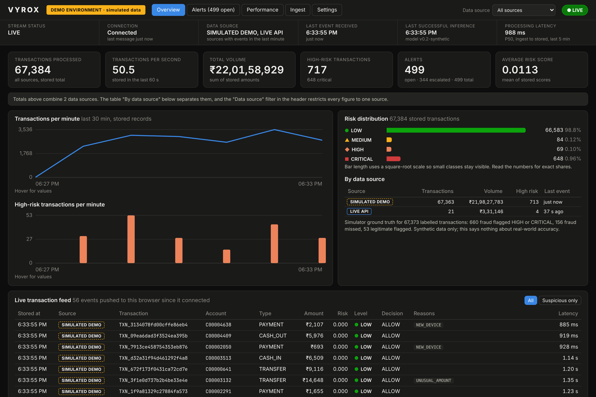
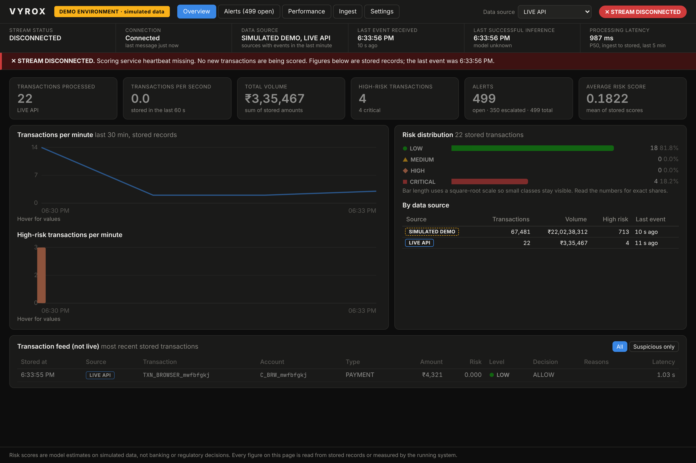

# VYROX: real-time payment fraud detection (v0.4)

Every transaction goes through one path: ingestion gateway, Kafka, Spark
Structured Streaming, feature store, model, PostgreSQL, alert engine, and a
push to the dashboard. Nothing on the dashboard is static, hardcoded or
animated for effect: each figure is read from stored records or measured by
the running system.

> **What this is not.** VYROX has no connection to live UPI, bank or
> card-network transactions. Real payment data can only arrive through an
> authorised provider integration that the operator sets up; none is bundled.
> The model is trained on this project's own simulator, so its accuracy
> figures say nothing about real fraud. Risk scores are model estimates for
> review, not banking or regulatory decisions.




The 3D panel at the top of the overview plots every transaction of the last
20 seconds: amount across, risk score up, age into the distance. Each point
is a stored record pushed by the backend, and points move only because they
age. When the stream is not live the clock stops, so the view freezes and
dims. It is a plain canvas with a hand-written projection (no WebGL, no 3D
library), capped at 20 frames per second and idle while hidden. In a headless
browser with software rendering it used about a quarter of one CPU core at 50
events per second; it can be switched off from the panel.

## The path of one transaction

```
 REST (API key)  ─┐
 Webhook (HMAC)  ─┤                      ┌─► DLQ topic (invalid records, with error headers)
 CSV / Parquet   ─┼─► Gateway ─► Kafka ──┤
 Demo generator  ─┘   validate    raw    └─► Spark Structured Streaming ─► Kafka "validated" topic
 Direct Kafka ────────idempotency topic        validate, forward               │
                      label source             + Bronze / Silver / Gold lake   ▼
                                                                         Scoring service
                                              Redis: history + behaviour features ◄─┤
                                              rules + LightGBM, reasons (TreeSHAP)  │
                                                                                    ▼
                         one PostgreSQL transaction: prediction + alert engine (dedup, priority,
                                                     assignment), then SLA-based escalation
                                                                                    │
                              Kafka "scored" topic (only after the commit) ◄────────┘
                                             │
                                  API ─► Server-Sent Events ─► dashboard
```

| Spec step | Where it happens |
|---|---|
| Receive, validate schema, idempotency, publish | `services/scorer/app/gateway.py`, `main.py` |
| Spark Structured Streaming | `services/streaming/stream_job.py` (forward query + lake queries) |
| Historical and behavioural features | `libs/fraudlib/features.py` (same code offline and online) |
| Prediction, risk level, reasons | `libs/fraudlib/scoring.py`, `rules.py`, `policy.py` |
| Save prediction, raise alerts | `services/scorer/app/repository.py` (one DB transaction) |
| Push to dashboards | `services/scorer/app/live.py` (SSE), `services/dashboard/src/live.ts` |

## Data sources and labels

Every stored transaction carries one of these labels. The gateway sets the
label; a caller cannot choose it.

| Label | How it arrives |
|---|---|
| `LIVE_API` | `POST /v1/transactions` with an API key |
| `LIVE_WEBHOOK` | `POST /v1/webhooks/generic`, HMAC-SHA256 over `"<timestamp>.<body>"`, 5-minute replay window |
| `KAFKA_STREAM` | another system produces directly to the transactions topic |
| `HISTORICAL_IMPORT` | `POST /v1/imports` with a CSV or Parquet file (50 MB, 500k rows) |
| `SIMULATED_DEMO` | the built-in generator and `POST /v1/demo/scenario`, demo environment only |

The webhook endpoint accepts VYROX's own envelope `{event_id, type, data}`.
A real payment gateway (Razorpay, Cashfree and so on) needs a small adapter
that verifies that provider's signature and maps its payload to the
transaction schema. That adapter is not written and is not claimed.

## Demo and production

`ENVIRONMENT` is `demo` or `production`. They never share data: Kafka topics
are prefixed with the environment, and each has its own database, Redis DB
and lake folder. In production:

- the services refuse to start with the demo API key or webhook secret,
- the generator refuses to run and `/v1/demo/scenario` does not exist,
- a `SIMULATED_DEMO` event is rejected at the gateway (403), by Spark and by the scorer (DLQ).

The dashboard shows the environment permanently in the header, labels every
row with its source, breaks totals down by source, and can filter every
figure to one source.

## Run it

Needs Docker and about 8 GB of free RAM with Spark, about 3 GB without.

```bash
cp .env.demo .env
make venv data train                     # synthetic data + model (needed once)
make up                                  # everything, PIPELINE_MODE from .env
# dashboard http://localhost:3000    API docs http://localhost:8000/docs
```

On a small machine set `PIPELINE_MODE=direct` in `.env` and start with
`docker compose --profile app up -d --build`. The scorer then reads the raw
topic and Spark is not in the scoring path (start it separately with
`make spark` if you want the lake).

Sign in to the dashboard as `admin` with the password from `ADMIN_PASSWORD` in `.env`
(`vyrox-demo-admin` in the demo file). Add named accounts for other people under the Admin tab.

Send something yourself:

```bash
curl -X POST localhost:8000/v1/transactions -H 'X-API-Key: dev-key' -H 'Content-Type: application/json' -d '{
  "transaction_id":"TXN_MINE_1","event_time":"2026-11-13T12:00:00+00:00","account_id":"C1",
  "counterparty_id":"M1","txn_type":"TRANSFER","amount":98000,"old_balance_orig":98500,"old_balance_dest":0}'
```

Fraud scenarios (`RAPID_BURST`, `ACCOUNT_TAKEOVER`, `UNUSUAL_AMOUNT`) are injected from the Ingest tab,
which needs an administrator.

## Documents for an evaluator

| Document | What it answers |
|---|---|
| [docs/SECURITY.md](docs/SECURITY.md) | What protects access and data, and what is missing |
| [docs/INTEGRATION.md](docs/INTEGRATION.md) | How to send transactions and read results |
| [docs/DEPLOYMENT.md](docs/DEPLOYMENT.md) | Running it on a server: HTTPS, backups, recovery, capacity |
| [docs/MODEL_CARD.md](docs/MODEL_CARD.md) | What the model is, what it was trained on, how far to trust it |

## Sign-in, roles and the audit log

| Caller | How it authenticates | What it may do |
|---|---|---|
| Viewer | username and password | read everything |
| Analyst | username and password | read, and work alerts (assign, review, confirm, dismiss) |
| Admin | username and password | everything: settings, imports, demo scenarios, people, audit log |
| Machine | `X-API-Key` | send transactions, dry-run scores, read. Nothing else. |

- Passwords are stored as salted scrypt hashes, at least 10 characters. Five failed sign-ins for one
  username from one address lock that pair out for 15 minutes.
- A sign-in returns a random session token valid for 8 hours. Only its SHA-256 digest is stored.
  Deactivating a person, changing their role or resetting their password ends their sessions at once.
- The browser holds the token for the life of the tab. No API key is built into the dashboard any more.
- An alert change is recorded under the signed-in person's name; the request cannot choose the actor.
- `audit_log` records every sign-in, failed sign-in, refused request, alert change, settings change
  (with before and after values), import, demo scenario and change to a user. The API only appends to it.
- The last active administrator cannot be demoted or deactivated.

What this is not: there is no single sign-on and no multi-factor sign-in. Database users can still alter
`audit_log`; making it tamper-evident needs restricted database roles or an external log store.

## HTTPS

```bash
# in .env:  DASHBOARD_API_URL=      (empty: the dashboard calls its own origin)
#           SITE_ADDRESS=localhost  (or a public host name for an automatic public certificate)
docker compose --profile app --profile tls up -d --build      # then open https://localhost
```

A Caddy proxy serves the dashboard and API on one origin, redirects HTTP to HTTPS and adds HSTS, a
content security policy and frame protection. `/metrics` is not published through it. Without this
profile, tokens and passwords cross the network in plain HTTP, which is only acceptable on localhost.

## Backups

```bash
docker compose --profile backup up -d                         # one archive every 24 h into ./backups
docker compose run --rm --entrypoint sh backup /tools/restore.sh /backups/<file>.dump vyrox_restored
```

Archives are checksummed and kept 14 days. A restore verifies the checksum and only ever creates a new
database. Tested: a restored copy had exactly the row counts of the live database. Copy the archives off
the machine; they are not encrypted.

## Model health

The Performance tab compares the last 24 hours of live model inputs with the training data, feature by
feature (Population Stability Index, also at `GET /v1/model/drift`). It reports that inputs have moved,
not that the model is wrong. In the demo it reads "drifted" after a fraud scenario or a load test, because
those change transaction velocity, which is the point of the check.

## Risk levels, decisions and alerts

The model's risk probability maps to four levels with configurable
thresholds (`GET/PUT /v1/config`, or the Settings tab; the scorer applies a
change within about 5 seconds):

| Level | Default threshold | Decision |
|---|---|---|
| LOW | below 0.30 | ALLOW |
| MEDIUM | 0.30 | ALLOW |
| HIGH | 0.60 | REVIEW |
| CRITICAL | 0.90 | HOLD |

Only features available at scoring time are used: no post-transaction
balances, no labels. Reason codes come from the rules that fired plus the
model's strongest TreeSHAP contributions, and a model reason is shown only
when its plain-language statement is true for that transaction.

Alert triggers: risk score at HIGH or above, or a rule in one of these groups
at MEDIUM or above: unusual frequency, anomalous amount, behaviour change
(new device with new counterparty and a large outflow), suspicious
relationship (many senders to one destination within an hour).

- **Deduplication**: one open alert per account; further suspicious
  transactions within 15 minutes attach to it and can raise its priority.
- **Prioritisation**: P1 CRITICAL, P2 HIGH, P3/P4 rule-only.
- **Assignment**: to the analyst with the fewest open alerts.
- **Escalation**: an alert not picked up within its response time (5, 15, 60, 240 minutes by priority) goes to the supervisor.

## Reliability

Delivery is **at-least-once with idempotent sinks**. It is not exactly-once
and does not claim to be.

| Concern | Mechanism |
|---|---|
| Duplicate prevention | Gateway idempotency key in Redis (24 h); `ON CONFLICT DO NOTHING` on `transaction_id`; alert link keyed by `transaction_id`; Redis feature writes are idempotent; Silver uses a Delta MERGE |
| Retries | Scorer retries infrastructure failures with backoff for as long as it takes, and commits Kafka offsets only after PostgreSQL and the outgoing topic are durable |
| Dead-letter queue | Invalid records (Spark) and events that fail three times (scorer) go to the DLQ topic with error, stage and origin headers |
| Event replay | `tools/replay.py dlq list`, `dlq replay`, `range --from --to`; safe to repeat |
| Consumer recovery | A restarted scorer resumes from its committed offsets; Spark resumes from checkpoints |
| Health | `/health/ready` checks Redis, PostgreSQL, Kafka and the scorer heartbeat |
| Monitoring | Prometheus metrics on the API and scorer; JSON logs on stdout |
| Never show old data as live | The dashboard states LIVE, IDLE, DELAYED, STREAM DISCONNECTED or NO CONNECTION TO SERVER, dims the figures and says when the last event was |

## Verified results

First run on 13 Nov 2026 in a 4-core, 16 GB Linux sandbox, with Kafka, Redis,
PostgreSQL and Spark in Docker and the Python services on the host.

On 15 Nov 2026 the images were built from this repository's Dockerfiles and the
whole stack ran from `docker compose --profile app --profile tls up` (direct
mode): all ten acceptance tests passed, and the browser check passed 17 of 17
through the HTTPS proxy. The sandbox added only its own proxy certificate to
the base images. The same ten acceptance tests also passed in Spark mode with
Spark running in its container.

### The ten acceptance tests

`tests/acceptance/test_acceptance.py` runs against the real stack with
nothing mocked. All ten pass in both pipeline modes
(`reports/acceptance_spark.json`, `reports/acceptance_direct.json`).
`tests/acceptance/browser_check.js` repeats 1, 6, 7 and 8 in a real browser
(`reports/browser_check.txt`).

| # | Test | Result | Evidence |
|---|---|---|---|
| 1 | Incoming transaction appears in the live feed | Pass | SSE event for the posted id; row visible in the browser 0.8 to 1.4 s after the POST (Spark mode) |
| 2 | It passes through Kafka | Pass | Same id found in the raw topic, the Spark-forwarded topic and the scored topic |
| 3 | The model generates an actual prediction | Pass | Stored score equals an independent `booster.predict` on the stored features |
| 4 | The risk score is persisted | Pass | Row in `predictions`; API returns the same values |
| 5 | A qualifying transaction generates an alert | Pass | P1 alert, assigned, linked to the transaction, pushed to the stream; a harmless payment raises none |
| 6 | Dashboard updates without manual refresh | Pass | Feed and KPIs changed with zero page navigations |
| 7 | Disconnecting the stream shows a disconnected state | Pass | Scorer stopped: shown in about 6.5 s. Kafka stopped: shown in 3 s and ingestion answers 503. API stopped: browser shows "no connection to server" |
| 8 | Reconnecting resumes processing | Pass | Events accepted during the outage were all scored about 7.5 s after restart; none lost |
| 9 | Duplicates create no duplicate transactions or alerts | Pass | 6 deliveries of one payment (3 REST retries, 1 webhook, 2 direct to Kafka): 1 prediction, 1 alert, event count 1 |
| 10 | Latency and throughput are measured, not invented | Pass | Stored latency equals the difference of two recorded timestamps; API percentiles match an independent SQL query; lag matches Kafka |

### Measured performance

Generator at 50 ticks per second (about 51 events per second), 60-second
windows of steady state, measured from stored rows
(`reports/latency_*_mode.json`).

| Stage | Spark mode P50 / P95 / P99 | Direct mode P50 / P95 / P99 |
|---|---|---|
| End to end (ingested to stored) | 628 / 1,118 / 1,367 ms | 30 / 52 / 104 ms |
| Feature retrieval (Redis) | 1.0 / 2.7 / 5.3 ms | 1.0 / 3.0 / 6.4 ms |
| Model inference | 0.29 / 0.50 / 2.6 ms | 0.33 / 0.48 / 2.3 ms |
| Stored to dashboard connection | 7.6 / 13 / 31 ms | not re-measured |
| Stored to browser (clock offset removed) | 8 / 55 / 78 ms (one browser, 526 samples) | not re-measured |
| REST request to Kafka acknowledgement | 1.2 / 4.2 / 4.2 ms (12 samples only) | not re-measured |

Maximum throughput, measured on 15 Nov 2026 with `tools/loadtest.py` (a burst of 30,000 events, then
the backlog's drain rate): **251.7 events per second** on the same 4-core sandbox, direct mode, one
scorer process (`reports/loadtest.json`). The scorer handles one event at a time with one database
transaction each; that is the limit. It is a measurement of that machine, not a promise for another.

Three things the measurements changed:

- The first Spark-mode run had an end-to-end P50 of about 7 s. The lake
  queries were starving the forward query (FIFO scheduling). Fix: FAIR
  scheduler pools and a single Kafka sink for the forward query.
- Scoring one row with LightGBM's default thread pool took about 16 ms.
  One thread takes about 0.03 ms. TreeSHAP (about 3 ms) now runs only for
  scores that need an explanation.
- The scorer's 250 ms poll timeout was most of direct-mode latency. It is 20 ms now.

**Spark in the scoring path costs about 600 ms.** That is the price of the
workflow as specified. Direct mode keeps Spark for the lake only and is the
better trade for latency.

### Model (synthetic data only)

200,000 simulated events, 1.2% fraud, time-based split, test set touched once
(`reports/train_v0.2-synthetic.json`). Threshold in this table is the one
that flags 1% of validation traffic.

| Model | Test PR-AUC | Precision | Recall |
|---|---|---|---|
| Rules baseline | 0.581 | 0.692 | 0.580 |
| Logistic regression | 0.985 | 0.997 | 0.922 |
| Random forest | 0.997 | 1.000 | 0.691 |
| LightGBM (deployed) | 0.996 | 1.000 | 0.808 |

These numbers are too good to mean much: the simulator's fraud patterns are
simple and the model learns the simulator. Two honest weaknesses showed up
live: with empty account history (first minutes of a fresh stream) recall at
the HIGH threshold was about 53% on 73 frauds, against about 94% in an
offline replay once accounts had history; and `hour_of_day` is constant in
the training data.

## Known gaps

- No real payment-gateway adapter and no live UPI, bank or card data.
- The SSE hub is in process memory: run one API worker. More replicas need Redis pub/sub or one Kafka consumer per replica (already how events arrive).
- Dashboard analytics run aggregate queries over the whole `predictions` table every 2 seconds. Fine for a demo, not for millions of rows.
- The fan-in feature shares state across accounts; with several scorer replicas two senders to one destination scored at the same instant can miss each other.
- The risk score is an uncalibrated model probability.
- Sign-in is username and password only: no single sign-on and no multi-factor.
- Single node: no high availability, no encryption at rest, no TLS between the internal services.
- No certification or compliance work (ISO 27001, SOC 2, PCI DSS, RBI, DPDP) and no penetration test.
- No synchronous approve-or-decline call: scoring is asynchronous, for review after submission.
- Login lock-out and rate limits are held in the API process, so they reset on restart and are per replica.
- "Spark backlog" on the dashboard is an approximation from topic offsets.
- PaySim results (all 6.3 million rows) are in docs/MODEL_CARD.md. They show the pipeline scales, not real accuracy.
- Not done from the original plan: IEEE-CIS training, Airflow, dbt, MLflow registry, AWS deployment.

## Tests

```bash
make test lint                 # 60 unit tests: feature parity, rules, tiers, gateway, webhook signature, imports
make acceptance                # the ten acceptance tests; needs the stack running
node tests/acceptance/browser_check.js docs/screenshots
```
